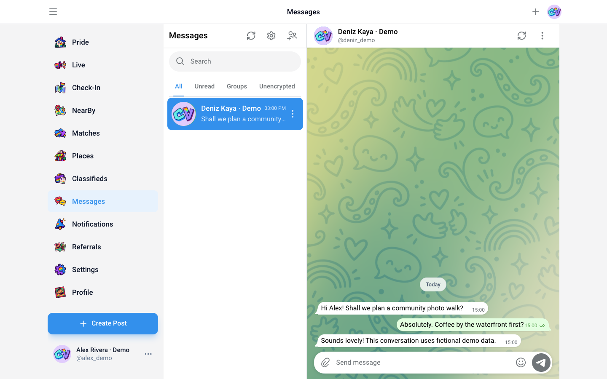
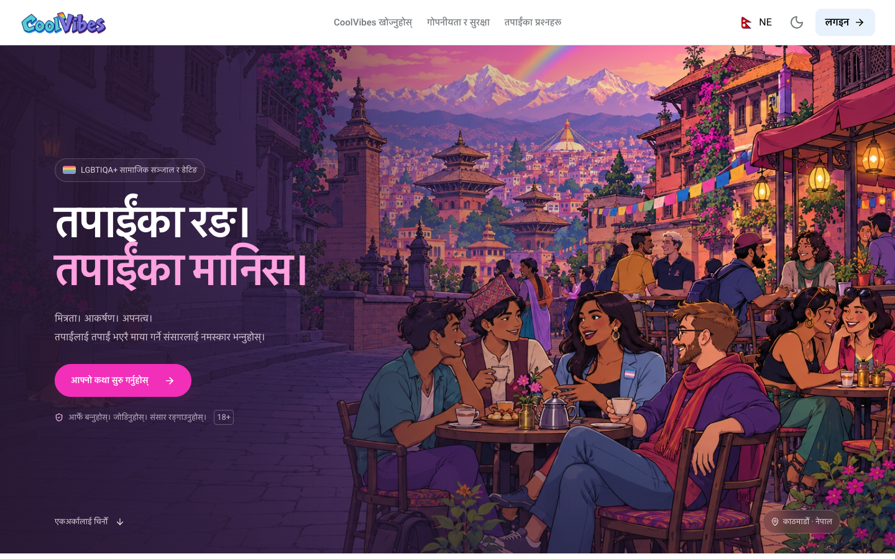
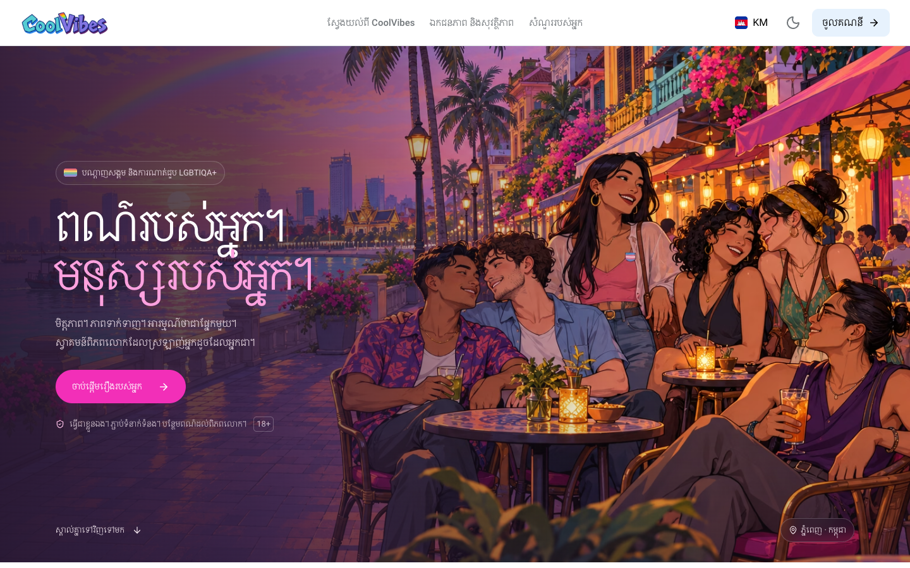

<p align="center">
  
</p>

# CoolVibes Web - Opensource LGBTIQA+ Social Network 

**Your colors. Your people.** A multilingual social and dating web application for the LGBTIQA+ community and respectful allies, aged 18 and over.

[Website](https://coolvibes.lgbt) · [Brandkit](https://coolvibes.lgbt/brandkit) · [Documentation contents](SUMMARY.md) · [Getting started](docs/guide/getting-started.md) · [Issues](https://github.com/CoolVibesLGBT/web/issues) · [Download for VS Code](https://marketplace.visualstudio.com/items?itemName=CoolVibes.coolvibes-vscode-extension)


## Read in your language

<!-- languages:start -->
[English](README.md) · [नेपाली](docs/readme/README.ne.md) · [ខ្មែរ](docs/readme/README.km.md) · [Türkçe](docs/readme/README.tr.md) · [Deutsch](docs/readme/README.de.md) · [Español](docs/readme/README.es.md) · [Français](docs/readme/README.fr.md) · [العربية](docs/readme/README.ar.md) · [বাংলা](docs/readme/README.bn.md) · [فارسی](docs/readme/README.fa.md) · [עברית](docs/readme/README.he.md) · [हिन्दी](docs/readme/README.hi.md) · [繁體中文（香港）](docs/readme/README.hk.md) · [Bahasa Indonesia](docs/readme/README.id.md) · [日本語](docs/readme/README.ja.md) · [조선말](docs/readme/README.kp.md) · [한국어](docs/readme/README.kr.md) · [Polski](docs/readme/README.pl.md) · [Português](docs/readme/README.pt.md) · [Русский](docs/readme/README.ru.md) · [ไทย](docs/readme/README.th.md) · [繁體中文（台灣）](docs/readme/README.tw.md) · [简体中文](docs/readme/README.zh.md)
<!-- languages:end -->

The app and this documentation include **23 locale variants**. Each localized overview uses its own landing-page hero. Chinese and Korean regional variants retain the application's existing locale codes. [Language reference](docs/guide/localization.md).

## What is CoolVibes?

CoolVibes brings community publishing, friendship, dating, nearby discovery and conversations into one responsive browser application. Members can build expressive profiles, share posts and media, find people and places, manage friendships and private-photo access, and personalize their experience.

This repository contains the **web frontend**, its static artwork and localization resources, and development fixtures. The API, account database, socket services, moderation operations and payment providers are separate services. A successful frontend build does not mean those services are configured or that every live workflow has been tested.

## Product scope

| Area | Frontend capabilities | Dependencies and boundaries |
| --- | --- | --- |
| Community feed | Posts, replies, media, reactions, bookmarks, polls, event creation and responses | Persistence, uploads, content availability and permissions come from the API |
| Profiles | Biography, personal attributes, interests, preferences, followers and engagement lists | Sensitive fields respect visibility settings; optional missing values remain explicit |
| Friends and photos | Friend requests, public/private photo tabs, upload review, photo-access requests and revocation | Private media requires server authorization; an interface control is not a substitute for it |
| Discovery and dating | Search, profile discovery, likes, matches and nearby views | Location permission, API results and feature gates apply |
| Places and check-ins | Place discovery, maps, business details and check-in flows | Place data and location services are external dependencies |
| Messaging | Private and group conversations, replies, edits, forwarding, pinned messages, attachments, stickers and GIFs | Socket/API services are required; the README does not claim end-to-end encryption |
| Groups | Member selection, group details, public/private groups and invitation links | Membership and invite validity are enforced by the service |
| Live | Broadcast discovery, camera/microphone setup and participation requests | Agora, media permissions, service tokens and membership gates apply |
| Classifieds | Community listings and requests, categories and detail screens | Listings are API-backed; categories do not imply verified providers or services |
| Wallet and referrals | Balance/history views, deposit/withdraw interfaces, referral links and rewards | Availability depends on backend and payment providers; some payment options are placeholders |
| Appearance | Light/dark/system themes, accent colors, message size, chat gradients and wallpaper | Preferences are retained locally; uploaded assets use the existing storage flow |
| Public pages | Localized landing, authentication entry, legal/community center and downloadable brandkit | Public reading is separate from account creation and authentication |

[Explore the product guide](docs/guide/product.md) for routes, interactions and practical limits.

## Screenshots

These are **browser captures of the actual application**, not design mockups. Authenticated screens use isolated fictional profiles and intercepted local API responses. No real accounts, private messages or production records were created for the screenshots. Localized landing screenshots use the appropriate regional hero artwork. [Capture method and reproduction](docs/guide/screenshots.md).

### Community feed and messaging




### Appearance and mobile profile


<p align="center"></p>

### Languages and regional artwork

| Arabic / RTL | Nepali | Khmer |
| --- | --- | --- |
|  |  |  |

[See Chinese, Japanese, Turkish, Hindi and Indonesian captures](docs/guide/screenshots.md).

## Technology

| Layer | Implementation |
| --- | --- |
| App | React 19, TypeScript, Vite 8 |
| Routing | Browser-history router in `src/router`; route composition in `src/App.tsx` |
| UI | Shared React controls, CSS/Tailwind, Lucide icons, Framer Motion/GSAP where used |
| Localization | i18next / react-i18next, locale JSON, RTL handling and region-specific heroes |
| Networking | Axios API client and Socket.IO client |
| Collections | `react-virtuoso` for existing virtualized long lists |
| Editing | Lexical editor modules, rich content, media and polling/event flows |
| Maps | Leaflet / React Leaflet and MapLibre GL |
| Live media | Agora RTC SDK |
| Quality | ESLint, custom interface regressions and Playwright fixture suites |

This is a **Vite SPA**, not a Next.js App Router application. `dist/` is generated output.

## Run locally

Use Node.js **22.12+ on the 22.x line**, or another version satisfying the installed Vite package (`^20.19.0 || >=22.12.0`), and Yarn Classic. The repository includes `yarn.lock`.

```bash
yarn install --frozen-lockfile
yarn dev
```

Open **http://localhost:5173** (or the port Vite prints if it is occupied). Public pages include `/landing`, `/legal` and `/brandkit`.

Authenticated functionality needs the separate backend. By default, local development uses HTTP **4001** and socket ports **4002/4003**, as configured in [`src/appSettings.tsx`](src/appSettings.tsx). No database setup or production account credentials are included here. [Configuration details](docs/guide/getting-started.md).

```bash
yarn lint
yarn build
yarn start
```

`yarn build` runs ESLint and creates the Vite bundle. `yarn start` runs **Vite preview**, a local preview server rather than a production hosting service. A deployment must serve `dist/`, provide SPA route fallback, and connect the required backend services.

## Repository map

```text
src/
  entry/          providers and application root
  router/         browser navigation and links
  screens/        route-level screens
  features/       auth, chat, profile, post, discovery, editor, maps, media...
  components/ui/  shared controls, dialogs, navigation and empty states
  contexts/       auth, settings, theme, sockets and shared state
  services/       HTTP client, API methods, actions and types
  locales/        common, landing, auth and legal strings per locale
  styles/         shared interface foundations
  seo/            metadata and locale registry
public/           icons, artwork, fonts, animations, manifest and worker
scripts/          regression checks, fixtures and documentation capture
docs/             guides, translated overviews, screenshots and audit evidence
```

[Architecture and integrations](docs/guide/architecture.md) explains the relationships between these areas.

## Interface and brand

CoolVibes combines a responsive interface with an expressive visual identity: the CoolVibes wordmark, CV app icon, turquoise and violet colors, and illustrations celebrating community.

The interface supports localized navigation, light and dark themes, keyboard operation, touch interaction and reduced-motion preferences.

The [Brandkit page](https://coolvibes.lgbt/brandkit) exposes the transparent wordmark, app icons, social cover, palette and ZIP download. Source files are in [`public/images/brand/dott-v3/`](public/images/brand/dott-v3/). These are raster assets; an editable vector master is not included.

## Verification and contribution

```bash
# Static and production checks
yarn lint
yarn build
node scripts/check-interface-regressions.mjs
node scripts/check-public-locales.mjs
node scripts/check-documentation.mjs

# Documentation screenshots: fictional local fixtures, no real account writes
node scripts/capture-readme.mjs
```

Playwright capture uses installed Chrome on macOS by default; `PLAYWRIGHT_CHANNEL` can select another installed channel. The fixture suites exercise DOM, canvas, media and API response behavior. They do not certify real-device behavior, production payments, email delivery or live broadcast reliability.

Keep changes focused, use the `@/` import alias for new shared imports, preserve permissions and localization, and record what you actually verified. Include reproduction steps and relevant visual evidence in pull requests. [Testing guide](docs/guide/testing.md).

## GitBook and GitHub

This README is the English landing page for both GitHub and a GitBook Git Sync space. [gitbook-docs.yaml](gitbook-docs.yaml) defines the site structure and maps CoolVibes Documentation to the repository root. [SUMMARY.md](SUMMARY.md) provides page navigation; [.gitbook.yaml](.gitbook.yaml) declares the space's root and entry files. In GitBook's Content mapping screen, choose `gitbook-docs.yaml` with the repository root as the Project directory. Translated overviews are ordinary Markdown pages with relative image links, so they remain usable in the repository too.

The files are **ready to import**; this change does not create or publish an external GitBook site. [GitBook setup](docs/guide/gitbook.md).

## Privacy, licensing and attribution

Privacy controls, blocking/reporting and sensitive-media visibility are part of the product, but this repository is not evidence of a completed security or accessibility certification. The current HTML includes Google Analytics integration, and external media providers can be used; this README therefore does not claim “no tracking.”

Package metadata declares **ISC**, while no top-level license text is currently present. Confirm the intended project license before redistribution. Third-party components retain their respective licenses.
