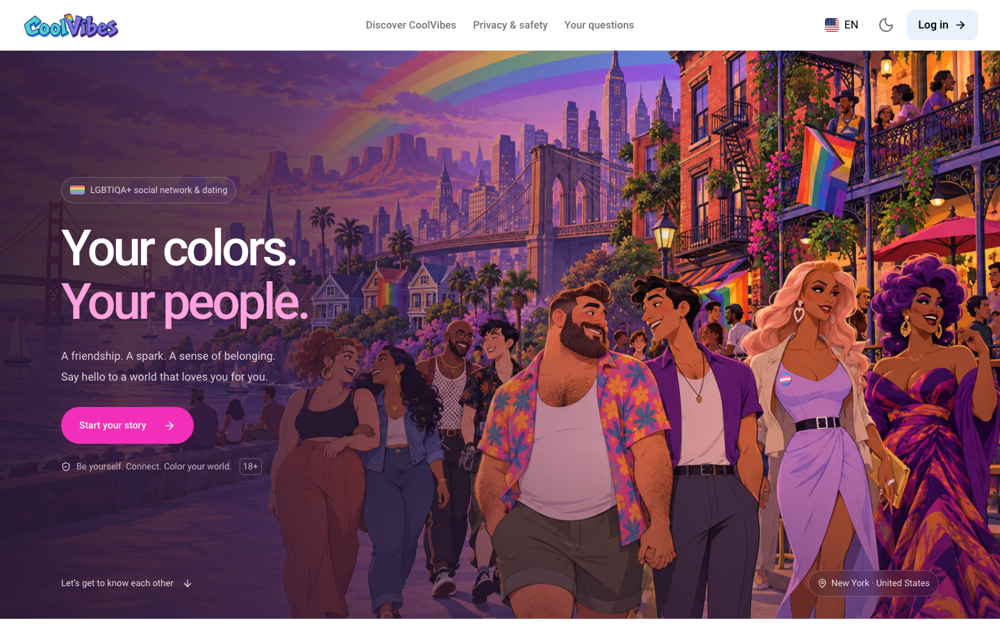
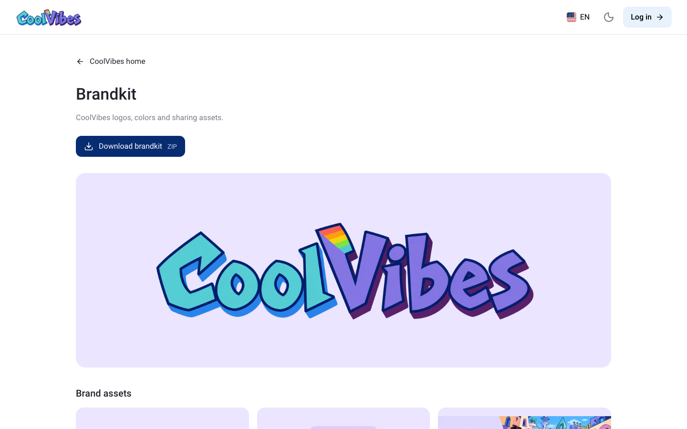
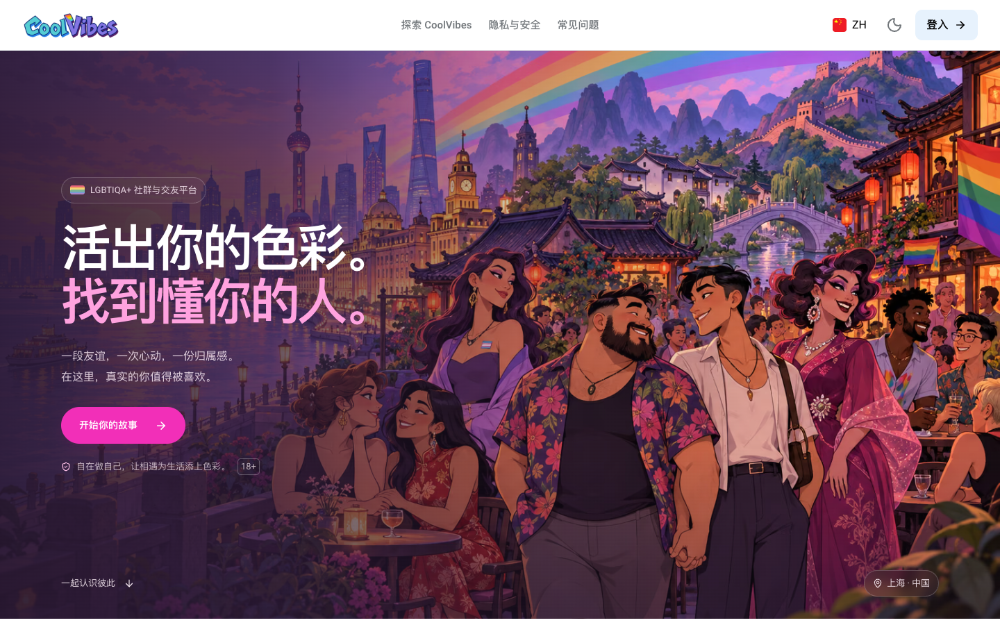
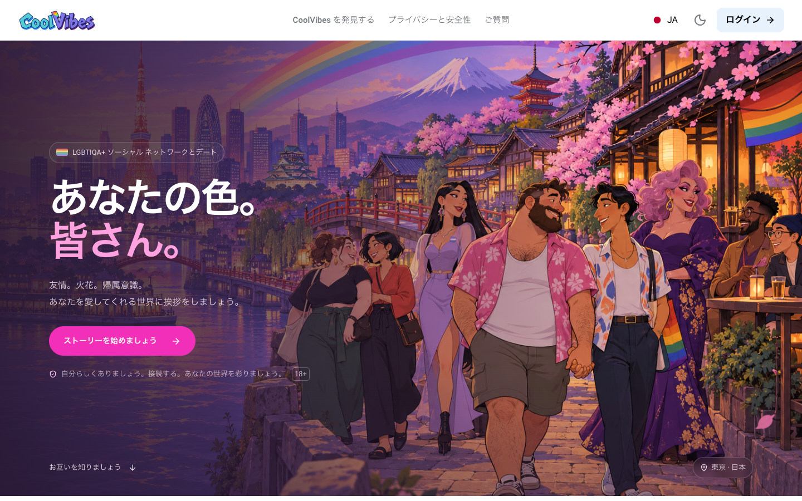
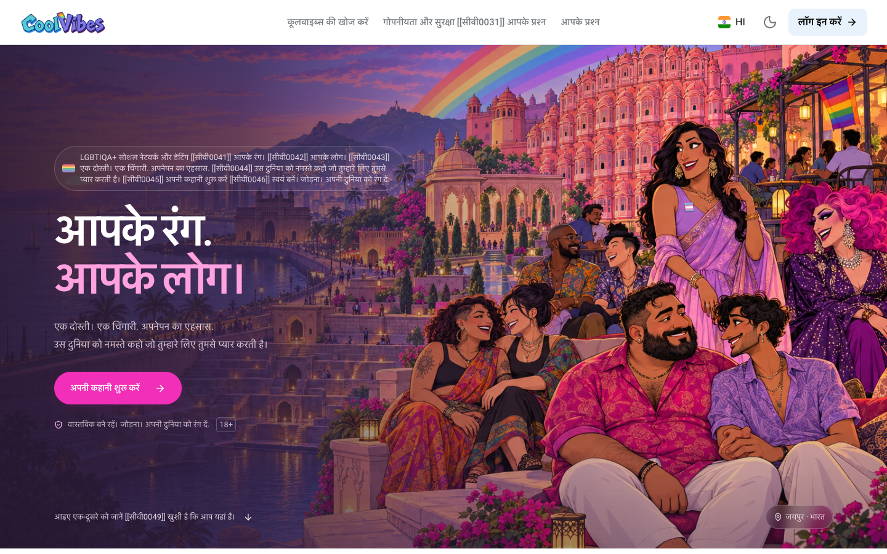
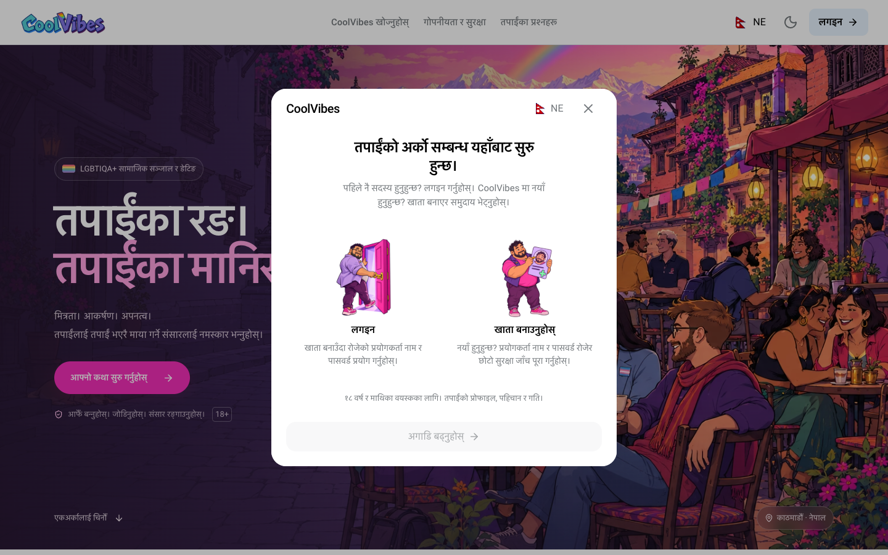
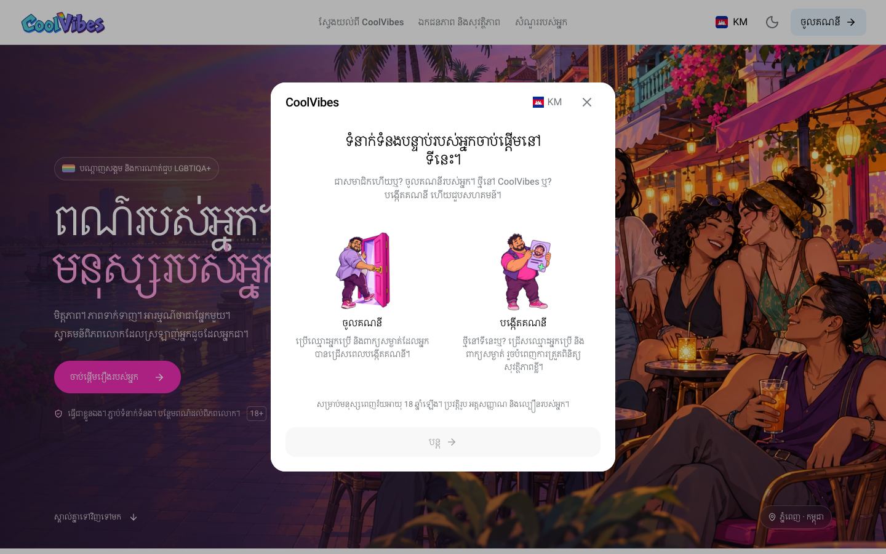
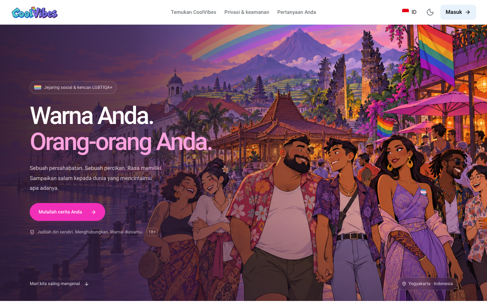

# Screenshot gallery

[Download CoolVibes for VS Code](https://marketplace.visualstudio.com/items?itemName=CoolVibes.coolvibes-vscode-extension)

These are captures of the running React application, using isolated fictional data. Alex Rivera and Deniz Kaya are demo identities, not registered members. Post images reuse packaged brand artwork. No production accounts, private conversations or database records were used or created.

## Reproduce

Start `yarn dev` on `http://localhost:5173`, then run:

```bash
node scripts/capture-readme.mjs
```

The script uses Playwright and the existing fixture layer, blocks external traffic, serves API responses locally, waits for content and image decoding, and saves PNG files plus a [capture manifest](../assets/screenshots/capture-manifest.json). Chrome is selected on macOS by default. Set `PLAYWRIGHT_CHANNEL` to another installed browser channel if needed.

These images show selected states, not an exhaustive acceptance test. Authenticated examples use English; nine public landing examples show localized interfaces and the matching hero. Nepali and Khmer also include login/register choice screens. Real-device rendering, server translations, payments, account registration and live broadcasts remain unverified.

## English feed with fictional profiles and a local sample post


## English messages with fictional conversation


## Appearance themes and chat preview


## Mobile fictional Alex Rivera profile


## en landing with locale-specific hero artwork



## CoolVibes Brandkit



## zh landing with locale-specific hero artwork



## ja landing with locale-specific hero artwork



## ar landing with locale-specific hero artwork


## tr landing with locale-specific hero artwork


## hi landing with locale-specific hero artwork



## ne landing with locale-specific hero artwork


## ne login/register choices



## km landing with locale-specific hero artwork


## km login/register choices



## id landing with locale-specific hero artwork


