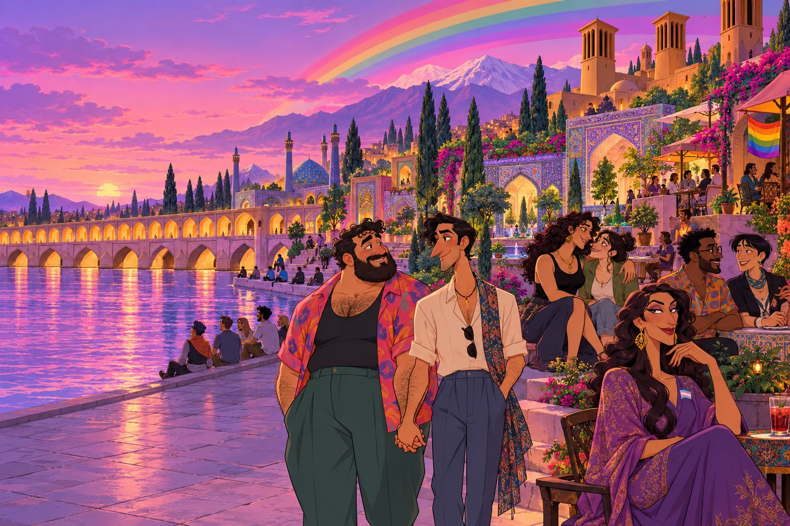

# CoolVibes — فارسی

[English](../../README.md) · [नेपाली](README.ne.md) · [ខ្មែរ](README.km.md) · [Türkçe](README.tr.md) · [Deutsch](README.de.md) · [Español](README.es.md) · [Français](README.fr.md) · [العربية](README.ar.md) · [বাংলা](README.bn.md) · [فارسی](README.fa.md) · [עברית](README.he.md) · [हिन्दी](README.hi.md) · [繁體中文（香港）](README.hk.md) · [Bahasa Indonesia](README.id.md) · [日本語](README.ja.md) · [조선말](README.kp.md) · [한국어](README.kr.md) · [Polski](README.pl.md) · [Português](README.pt.md) · [Русский](README.ru.md) · [ไทย](README.th.md) · [繁體中文（台灣）](README.tw.md) · [简体中文](README.zh.md)



## درباره پروژه

CoolVibes برنامه‌ای برای شبکه اجتماعی، دوستی و آشنایی در جامعه LGBTIQA+ و همراهان محترم آن است و برای افراد ۱۸ سال به بالا طراحی شده است. این مخزن شامل رابط وب، ترجمه‌ها، تصویرسازی‌ها و آزمون‌های محلی است. API، پایگاه داده و پرداخت‌ها سرویس‌های جداگانه‌اند.

## امکانات و محدوده

فید شامل نوشته، عکس، ویدیو، پاسخ، واکنش، نشانک، نظرسنجی و رویداد است. پروفایل‌ها زندگی‌نامه، علاقه‌ها، ترجیحات، دنبال‌کنندگان، درخواست دوستی و عکس‌های خصوصی با کنترل دسترسی دارند. جست‌وجو، تطبیق، افراد نزدیک، نقشه، مکان‌ها، ثبت حضور و آگهی‌ها به کشف جامعه کمک می‌کنند. گفت‌وگوی خصوصی و گروهی از پاسخ، بازفرستادن، سنجاق، رسانه، برچسب و GIF پشتیبانی می‌کند. پخش زنده، کیف پول، معرفی و Premium وابسته به سرویس‌ها و تنظیمات قابلیت‌ها هستند.

## فناوری و راه‌اندازی

رابط با React 19، TypeScript وVite 8 ساخته شده است. i18next، Axios، Socket.IO، Lexical، فهرست‌های مجازی، Leaflet/MapLibre وAgora نیز استفاده می‌شوند. به Yarn ونسخه سازگار Node.js نیاز دارید. فرمان‌های زیر معمولاً localhost:5173 را اجرا می‌کنند؛ API محلی روی 4001 وسرویس‌های socket روی 4002/4003 هستند.

```bash
yarn install --frozen-lockfile
yarn dev

# Checks
yarn lint
yarn build
node scripts/check-documentation.mjs
```

## زبان‌ها و برند

برنامه ۲۳ گونه زبانی دارد، از جمله نپالی وخمری. هر صفحه تصویر اصلی منطقه‌ای خود را دارد. فارسی، عربی وعبری راست‌به‌چپ هستند. هویت انتخاب‌شده dott-v3 شامل نوشته CoolVibes، نماد CV ورنگ‌های فیروزه‌ای وبنفش است. /brandkit لوگوها، نمادها، تصویر اجتماعی وZIP ارائه می‌دهد.

## بررسی و مشارکت

تصاویر از رابط واقعی با پروفایل‌های خیالی محلی گرفته شده‌اند؛ حساب واقعی یا پیام خصوصی استفاده نشده است. آزمون مرورگر تأیید دستگاه واقعی، پرداخت یا پخش زنده نیست. ترجمه‌های جدید به بازبینی بومی نیاز دارند. فراداده ISC را اعلام می‌کند اما متن مجوز اصلی وجود ندارد؛ پیش از بازتوزیع بررسی کنید. راهنماهای انگلیسی معماری، خدمات ووارد کردن به GitBook را توضیح می‌دهند.


[English technical guides](../guide/getting-started.md) · [Product scope](../guide/product.md) · [Architecture](../guide/architecture.md) · [Languages](../guide/localization.md) · [Screenshots](../guide/screenshots.md) · [GitBook](../guide/gitbook.md)
