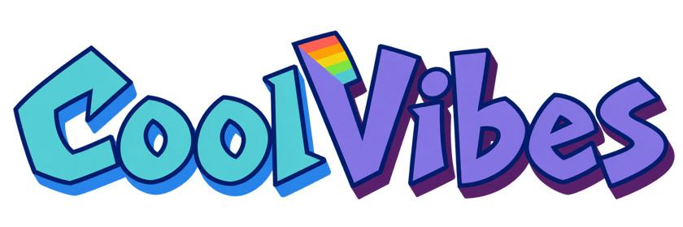
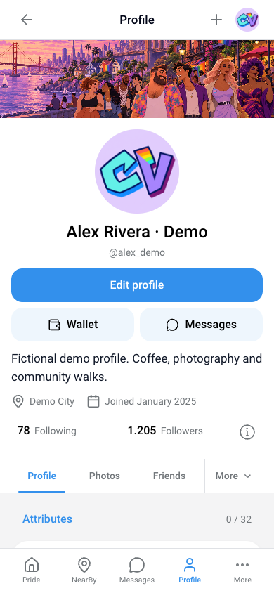

# CoolVibes — Русский

[English](../../README.md) · [नेपाली](README.ne.md) · [ខ្មែរ](README.km.md) · [Türkçe](README.tr.md) · [Deutsch](README.de.md) · [Español](README.es.md) · [Français](README.fr.md) · [العربية](README.ar.md) · [বাংলা](README.bn.md) · [فارسی](README.fa.md) · [עברית](README.he.md) · [हिन्दी](README.hi.md) · [繁體中文（香港）](README.hk.md) · [Bahasa Indonesia](README.id.md) · [日本語](README.ja.md) · [조선말](README.kp.md) · [한국어](README.kr.md) · [Polski](README.pl.md) · [Português](README.pt.md) · [Русский](README.ru.md) · [ไทย](README.th.md) · [繁體中文（台灣）](README.tw.md) · [简体中文](README.zh.md)


## О проекте

CoolVibes объединяет социальную сеть, дружбу и знакомства для сообщества LGBTIQA+ и уважающих его союзников от 18 лет. Репозиторий содержит веб-клиент, переводы, иллюстрации и локальные тестовые сценарии. API, база данных и платёжные системы работают отдельно.

## Возможности

Лента включает публикации, фото, видео, ответы, реакции, закладки, опросы и события. Профили содержат биографию, интересы, предпочтения, подписчиков, заявки в друзья и приватные фото с разрешениями. Поиск, совпадения, люди рядом, карты, места, отметки посещений и объявления помогают находить сообщество. Личные и групповые чаты поддерживают ответы, пересылку, закрепление, медиа, стикеры и GIF. Трансляции, кошелёк, рекомендации и Premium зависят от сервисов и настроек функций.

## Технологии и запуск

Клиент построен на React 19, TypeScript и Vite 8, а не Next.js. Используются браузерная маршрутизация, i18next, Axios, Socket.IO, Lexical, виртуализированные списки, Leaflet/MapLibre и Agora. Нужны Yarn и совместимая с Vite версия Node.js. Команды ниже обычно запускают localhost:5173. Локальное API ожидается на 4001, сокеты — на 4002/4003.

```bash
yarn install --frozen-lockfile
yarn dev

# Checks
yarn lint
yarn build
node scripts/check-documentation.mjs
```

## Языки и бренд

Приложение включает 23 языковых варианта, в том числе непальский и кхмерский. Каждая языковая страница использует региональную иллюстрацию. Арабский, персидский и иврит поддерживают RTL. Выбран стиль dott-v3: надпись CoolVibes, значок CV, бирюзовый и фиолетовый. /brandkit предоставляет логотипы, значки, обложку и ZIP.

## Проверки и участие

Снимки показывают настоящий интерфейс с вымышленными локальными профилями, без производственных аккаунтов и личных сообщений. Тесты браузера не подтверждают работу на реальных устройствах, платежей или трансляций. Новые непальские и кхмерские тексты желательно проверить носителям языка. Метаданные указывают ISC, но корневой текст лицензии отсутствует; уточните её перед распространением. Английские руководства объясняют сервисы, ограничения и импорт в GitBook.




[English technical guides](../guide/getting-started.md) · [Product scope](../guide/product.md) · [Architecture](../guide/architecture.md) · [Languages](../guide/localization.md) · [Screenshots](../guide/screenshots.md) · [GitBook](../guide/gitbook.md)
